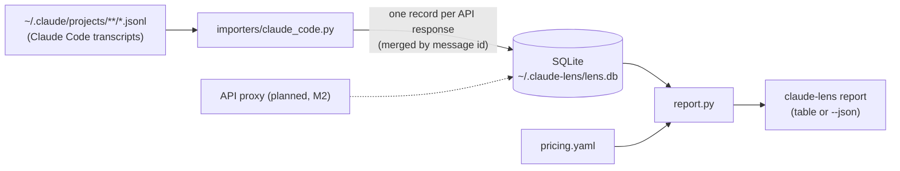

# claude-lens

`claude-lens` shows what Claude actually costs you, and why. It reads Claude Code session
transcripts, stores each API response in a local SQLite database, and reports API-equivalent
cost, token usage and the **prompt-cache hit ratio** by day, project, model or session.

It is the observability companion to [claude-guard](https://github.com/rkrzywiecki/claude-guard).
claude-guard decides what may pass; claude-lens only watches, never blocks, and never changes
traffic.



**Status:** milestone M1 (transcript importer and reports). The API proxy, cache doctor, loop
detection and dashboard are planned; see [Roadmap](#roadmap).

## Requirements

- Python 3.12+
- [uv](https://docs.astral.sh/uv/)
- Claude Code transcripts on disk (`~/.claude/projects`). No API key is needed: nothing calls the
  Claude API.

## Installation

```bash
curl -LsSf https://astral.sh/uv/install.sh | sh
git clone https://github.com/rkrzywiecki/claude-lens.git
cd claude-lens
uv sync
cp .env.example .env
```

## Usage

```bash
uv run claude-lens import                     # import new or changed transcripts
uv run claude-lens report                     # cost per day (imports changes first)
uv run claude-lens report --by project --days 7
uv run claude-lens report --by session --top 10
uv run claude-lens report --by model --since 2026-10-01 --until 2026-10-15
uv run claude-lens report --project claude-guard --json
```

`report` imports changed transcripts before reporting (`--no-refresh` skips that). The import is
incremental: files whose size and modification time did not change are skipped, and records are
keyed by message id, so importing twice never double-counts. `import --full` re-reads every file.

Columns:

| Column | Meaning |
|---|---|
| Input | Uncached input tokens |
| Cache write | Tokens written to the prompt cache (5-minute and 1-hour TTL together) |
| Cache read | Tokens served from the prompt cache |
| Hit ratio | `cache read / (input + cache write + cache read)` |
| Saved | Cost of the same tokens with no caching, minus the actual cost. **Negative means caching cost you money**: writes are billed at 1.25x or 2x input, so a prefix that is written and never read again is more expensive than not caching it |
| Cost | API-equivalent cost at list prices from `pricing.yaml` (`*` marks rows with unpriced models) |

The **Total** row always covers every request in the selected range, also when `--top` hides some
rows.

## Configuration

Settings come from environment variables (or `.env`):

| Variable | Default | Description |
|---|---|---|
| `LENS_DB_PATH` | `~/.claude-lens/lens.db` | SQLite database |
| `LENS_TRANSCRIPTS_DIR` | `~/.claude/projects` | Root of the Claude Code transcripts |
| `LENS_PRICING_PATH` | *(bundled table)* | Custom `pricing.yaml` |
| `LENS_LOG_LEVEL` | `WARNING` | Log level of the JSON logs on stderr |

Prices live in [`src/claude_lens/data/pricing.yaml`](src/claude_lens/data/pricing.yaml) (USD per
million tokens). To change or add a model, copy the file, edit it and point `LENS_PRICING_PATH` at
it. Its format is described in [docs/pricing.md](docs/pricing.md).

## Examples

The repository ships two synthetic sessions in `examples/transcripts`: one keeps a stable prompt
prefix, the other changes the prefix every turn, so it never reads from the cache.

```bash
export LENS_TRANSCRIPTS_DIR=examples/transcripts LENS_DB_PATH=examples/demo.db
uv run claude-lens report --by session
```

```
API-equivalent cost by session
┏━━━━━━━━━━━━━━━━━━━━━━━━━━━━━━━━━━┳━━━━━━━━━━┳━━━━━━━┳━━━━━━━━━━━━━┳━━━━━━━━━━━━┳━━━━━━━━┳━━━━━━━━━━━┳━━━━━━━━┳━━━━━━━┓
┃ Session                          ┃ Requests ┃ Input ┃ Cache write ┃ Cache read ┃ Output ┃ Hit ratio ┃  Saved ┃  Cost ┃
┡━━━━━━━━━━━━━━━━━━━━━━━━━━━━━━━━━━╇━━━━━━━━━━╇━━━━━━━╇━━━━━━━━━━━━━╇━━━━━━━━━━━━╇━━━━━━━━╇━━━━━━━━━━━╇━━━━━━━━╇━━━━━━━┩
│ 7b2e4d10  2026-10-14 11:00       │       12 │    36 │      372.0k │          0 │   9.6k │        0% │ -$0.19 │ $1.03 │
│ /home/dev/blog                   │          │       │             │            │        │           │        │       │
│ 1f0c9a52  2026-10-14 11:00       │       12 │    36 │       18.0k │     372.0k │   9.6k │       95% │  $1.40 │ $0.36 │
│ /home/dev/shop                   │          │       │             │            │        │           │        │       │
├──────────────────────────────────┼──────────┼───────┼─────────────┼────────────┼────────┼───────────┼────────┼───────┤
│ Total                            │       24 │    72 │      390.0k │     372.0k │  19.2k │       49% │  $1.21 │ $1.38 │
└──────────────────────────────────┴──────────┴───────┴─────────────┴────────────┴────────┴───────────┴────────┴───────┘
```

Both sessions do the same work. The cache-busting one costs almost three times as much and shows
negative savings. Session times are shown in your local time zone.

Machine-readable output for scripts and dashboards:

```bash
uv run claude-lens report --by model --json
```

`scripts/make_example_transcripts.py` regenerates the example files.

## Tests and quality

```bash
uv run pytest -q
uv run pytest -q --cov
uv run ruff check . && uv run ruff format --check . && uv run mypy src
```

## Limitations

- **Costs are API-equivalent list prices.** On a Claude subscription you do not pay per token;
  the numbers show what the same usage would cost on the API. Batch, Priority Tier, regional and
  partner-platform pricing are not modeled, nor are server-tool fees (web search).
- **Transcripts do not record every API call.** Claude Code makes side requests (for example
  session titles) that never reach the transcript. On real data, totals came out about 4% below
  the cost Claude Code reports itself; most sessions match exactly. The planned proxy will see
  every request.
- **The transcript format is not a stable API.** The importer is tolerant (unknown records are
  skipped, malformed lines counted), but a format change can make fields disappear. Tests use
  record shapes copied from Claude Code 2.1.x transcripts.
- Prompt contents are never stored: only ids, timestamps, model, token counts and tool names.
- Prices in the bundled table were checked on 2026-10-16 and will go stale; check them against the
  [pricing page](https://platform.claude.com/docs/en/about-claude/pricing).

## Roadmap

1. **M1 (done):** transcript importer, SQLite store, `report`.
2. **M2:** pass-through API proxy (`ANTHROPIC_BASE_URL`) with an SSE tee: usage, latency (TTFT,
   total), every request including side calls.
3. **M3:** `cache-doctor <session>` (which prefix segment changed between turns: tools, system,
   messages), loop detection (same tool and input repeated, error streaks), context growth.
4. **M4:** local web dashboard.

## License

Apache-2.0
