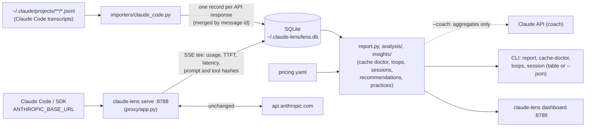

# claude-lens

`claude-lens` shows what Claude actually costs you, and why. It reads Claude Code session
transcripts and, optionally, records live API traffic through a pass-through proxy. Each API
response is stored in a local SQLite database, and reports show API-equivalent cost, token usage
and the **prompt-cache hit ratio** by day, project, model or session. The **cache doctor** finds
requests that missed the prompt cache and says why and what it cost, **loop detection** flags
agents repeating themselves, **insights** turn all of it into recommendations (which model and
effort to use, how to keep context small, which best practices you follow), optionally with a
plan written by Claude, and a local **dashboard** shows it all on one page.

It is the observability companion to [claude-guard](https://github.com/rkrzywiecki/claude-guard).
claude-guard decides what may pass; claude-lens only watches, never blocks, and never changes
traffic.



**Status:** milestones M1-M5 are done: transcript importer and reports, API proxy, cache doctor
and loop detection, dashboard, insights. Live nudges in Claude Code (status line, prompt hook,
plugin) are done too. See [Roadmap](#roadmap).

## Requirements

- Python 3.12+
- [uv](https://docs.astral.sh/uv/)
- Claude Code transcripts on disk (`~/.claude/projects`), the proxy, or both. claude-lens needs
  no API key of its own: the importer calls no API, and the proxy forwards the client's
  credentials (`ANTHROPIC_API_KEY` or a Claude Code login) unchanged.
- Only the optional coach (`insights --coach`) talks to Claude: through the API when
  `ANTHROPIC_API_KEY` (or an `ant auth login` profile) is set, otherwise through your signed-in
  Claude Code CLI (`claude -p`), so a claude.ai subscription is enough.

## Installation

```bash
curl -LsSf https://astral.sh/uv/install.sh | sh
git clone https://github.com/rkrzywiecki/claude-lens.git
cd claude-lens
uv sync
cp .env.example .env
```

## Usage

```bash
uv run claude-lens import                     # import new or changed transcripts
uv run claude-lens report                     # cost per day (imports changes first)
uv run claude-lens report --by project --days 7
uv run claude-lens report --by session --top 10
uv run claude-lens report --by model --since 2026-10-01 --until 2026-10-15
uv run claude-lens report --project claude-guard --json
uv run claude-lens cache-doctor --days 30     # prompt-cache misses, causes, avoidable cost
uv run claude-lens loops --days 30            # repeated calls, error streaks, file churn
uv run claude-lens insights --days 30         # recommendations and best-practice scorecard
uv run claude-lens whatif --to claude-sonnet-5-5 --from opus   # reprice Opus traffic on Sonnet
uv run claude-lens dashboard                  # local web dashboard on http://127.0.0.1:8789
```

`claude-lens session <id>` shows one session; ids come from `report --by session` or
`cache-doctor`, and a unique prefix is enough ([example](#examples)).

Every analysis command imports changed transcripts first (`--no-refresh` skips that). The import is
incremental: files whose size and modification time did not change are skipped, and records are
keyed by message id, so importing twice never double-counts. `import --full` re-reads every file.

Columns:

| Column | Meaning |
|---|---|
| Input | Uncached input tokens |
| Cache write | Tokens written to the prompt cache (5-minute and 1-hour TTL together) |
| Cache read | Tokens served from the prompt cache |
| Hit ratio | `cache read / (input + cache write + cache read)` |
| Saved | Cost of the same tokens with no caching, minus the actual cost. **Negative means caching cost you money**: writes are billed at 1.25x or 2x input, so a prefix that is written and never read again is more expensive than not caching it |
| Cost | API-equivalent cost at list prices from `pricing.yaml` (`*` marks rows with unpriced models) |

The **Total** row always covers every request in the selected range, also when `--top` hides some
rows.

## Cache doctor, loops and sessions

**`cache-doctor`** compares consecutive requests of each conversation (same session and model,
subagents excluded) and reports a miss when a request reads markedly less from the cache than
the previous one had cached. Each miss gets a cause:

| Cause | Meaning |
|---|---|
| prefix changed | The proxy saw which part of the prompt changed: tool definitions, system prompt, thinking/effort/tool_choice, or an earlier message |
| TTL expired | The pause was longer than the cache TTL (5 minutes, or 1 hour) |
| unexplained | Within the TTL with no visible change; from transcripts most prefix changes land here |
| context reset | The prompt shrank by more than half (compaction, `/clear`); expected, no penalty |

The **penalty** is what re-sending the lost prefix cost minus what reading it would have cost.
**Avoidable** counts changed prefixes, unexplained misses, and 5-minute entries that expired
during a pause of up to an hour. The command ends with concrete advice (1-hour TTL or keep-alive,
the segment that changes most often, missing `cache_control`).

**`loops`** reads tool calls (only a hash of each input is stored, plus the file path for file
tools) and flags the same call repeated 3+ times, 3+ tool errors in a row, and a file edited 5+
times in a session. They are signals, not verdicts.

**`session <id>`** takes a session id or a unique prefix and shows the request timeline (prompt,
cache read and write, output, cost, tools, miss cause), how full the context got relative to the
model's window, and the session's loops.

Rules, thresholds and the penalty formula: [docs/analysis.md](docs/analysis.md).

## Insights

`claude-lens insights` reads everything above (tokens, effort, thinking, subagents, tool calls,
cache misses, loops, session metadata such as interruptions and permission modes, and CLAUDE.md
in your project directories) and answers "what should I change?":

- **Model:** Opus or Fable sessions that only read and answered (priced on Sonnet), subagents
  running on the largest model (priced on Haiku), short API answers from big models.
- **Effort:** high effort on light work where thinking dominates the output; low effort in
  sessions that struggled.
- **Context:** long sessions that kept growing without `/clear`, sessions near the context
  window.
- **Workflow:** investigation in the main conversation instead of subagents, multi-file changes
  without plan mode, rework (repeated edits, error streaks, interruptions), permission prompts.
- **Setup:** projects without CLAUDE.md, CLAUDE.md over 200 lines.
- **Cache and API apps:** avoidable cache misses, large prompts without `cache_control`, large
  `max_tokens` without streaming, batch candidates.

Each recommendation shows the evidence, the sessions, a documentation link, and where possible
a saving marked as *repriced*, *estimate* or *up to*. A **best-practice scorecard** shows
pass/warn/fail for practices from the Claude Code and Claude API documentation. `whatif`
reprices any slice of traffic on another model.

`--coach` adds a short plan written by Claude from the aggregated numbers only (no paths,
session ids or prompts; `--dry-run` shows the payload), in the language of your choice. It uses
the API when a key is set, otherwise your Claude Code login, so it works on a subscription
without an API key. Logs show
cost, not quality: cheaper models and lower effort are presented as experiments. Details, rules
and thresholds: [docs/insights.md](docs/insights.md).

## Dashboard

```bash
uv run claude-lens dashboard
```

Opens on `http://127.0.0.1:8789` and imports changed transcripts when the page loads. One row of
filters (7/30/90 days or all, project) scopes totals, the recommendations and best-practice
scorecard (with **Ask Claude for a plan**), cost per day stacked by token kind, cost by model and
project, the cache doctor, loops, and a session view with a prompt-size chart that marks every
cache miss. It follows the system light or dark mode, works at phone width, and loads
nothing from the network. It has no authentication: it binds to loopback, answers only
loopback `Host` headers, and its POST actions (import, coach) require a header other sites cannot
send. Details: [docs/dashboard.md](docs/dashboard.md).

## Live nudges in Claude Code

Reports explain waste afterwards; the live commands show it while you work:

```bash
uv run claude-lens install            # status line + nudge hook in .claude/settings.json
uv run claude-lens install --user     # the same in ~/.claude/settings.json
```

- **Status line:** `Opus · ctx 180k/1M (18%) · $0.54 · cache warm 41m left (1h)`: context size
  and its share of the window, the session's API-equivalent cost so far, and whether the prompt
  cache is still warm. It reads the session transcript incrementally (about 130 ms per run on a
  14 MB transcript).
- **Nudge hook** (`UserPromptSubmit`): once a session has 8+ prompts and 150k+ tokens of
  context, or fills 60% of the window, Claude Code shows a one-time suggestion to `/rename` +
  `/clear` or `/compact <focus>`. Same thresholds as `insights`; it never blocks a prompt.
- **Plugin:** [`plugin/`](plugin/) packages the hook and a `/lens` skill that runs `insights`
  (`claude plugin validate ./plugin`, then `claude --plugin-dir ./plugin`).

`install` keeps your other settings, backs up the previous file, and leaves a status line that is
not claude-lens's alone unless `--force`. Details: [docs/nudges.md](docs/nudges.md).

## API proxy

Transcripts miss some API calls (Claude Code's side requests, such as session titles) and carry no
timing. The proxy sees every call: run it and point `ANTHROPIC_BASE_URL` at it.

```bash
uv run claude-lens serve
export ANTHROPIC_BASE_URL=http://127.0.0.1:8788
claude
```

Every `/v1/*` request is forwarded to `https://api.anthropic.com` unchanged (headers, body,
streaming, errors). For each `POST /v1/messages` response the proxy records usage, model, stop
reason, tool calls (input hashed), time to the first content block (`ttft_ms`), total latency
(`latency_ms`) and a hash of each prompt segment (for the cache doctor), in the same database the importer uses, so `report` covers both sources and
counts a response seen by both once. Recording runs on a background thread and fails open: a
broken database never affects a response. No prompt content is stored.

Sessions come from the `x-lens-session` header, from the session id Claude Code sends in request
`metadata` (the same id as its transcripts), or from message-prefix continuation; the project from
the `x-lens-project` header or the working directory in Claude Code's system context.

With [claude-guard](https://github.com/rkrzywiecki/claude-guard), chain the guard first:

```
client -> claude-guard :8787 -> claude-lens :8788 -> api.anthropic.com
```

```bash
uv run claude-lens serve                                         # in claude-lens
GUARD_UPSTREAM_URL=http://127.0.0.1:8788 uv run claude-guard serve   # in claude-guard
export ANTHROPIC_BASE_URL=http://127.0.0.1:8787
claude
```

The proxy listens on `127.0.0.1` only, unless `--allow-non-loopback` is given (plain HTTP: put TLS
in front). `curl http://127.0.0.1:8788/healthz` shows how many records were written. Details:
[docs/proxy.md](docs/proxy.md).

## Configuration

Settings come from environment variables (or `.env`):

| Variable | Default | Description |
|---|---|---|
| `LENS_DB_PATH` | `~/.claude-lens/lens.db` | SQLite database |
| `LENS_TRANSCRIPTS_DIR` | `~/.claude/projects` | Root of the Claude Code transcripts |
| `LENS_PRICING_PATH` | *(bundled table)* | Custom `pricing.yaml` |
| `LENS_LOG_LEVEL` | `WARNING` | Log level of the JSON logs on stderr |
| `LENS_UPSTREAM_URL` | `https://api.anthropic.com` | Proxy: where requests are forwarded |
| `LENS_UPSTREAM_TIMEOUT` | `600` | Proxy: upstream timeout in seconds |
| `LENS_HOST` | `127.0.0.1` | Proxy: listen address |
| `LENS_PORT` | `8788` | Proxy: listen port |
| `LENS_ALLOW_NON_LOOPBACK` | `false` | Proxy: allow a non-loopback listen address |
| `LENS_COACH_MODEL` | `claude-opus-5-5` | Coach: model that writes the plan |
| `LENS_COACH_EFFORT` | `medium` | Coach: effort level |
| `LENS_COACH_LANGUAGE` | `English` | Coach: language of the plan |
| `LENS_COACH_TIMEOUT` | `120` | Coach: timeout in seconds |
| `LENS_COACH_BACKEND` | `auto` | Coach: `api`, `claude-code` (`claude -p` with your Claude Code login) or `auto` |
| `LENS_COACH_CLAUDE_BIN` | `claude` | Coach: Claude Code CLI for the `claude-code` backend |
| `LENS_STATE_DIR` | `~/.claude-lens/state` | Live commands: transcript read positions, nudges shown (process env only, not `.env`) |

Prices live in [`src/claude_lens/data/pricing.yaml`](src/claude_lens/data/pricing.yaml) (USD per
million tokens). To change or add a model, copy the file, edit it and point `LENS_PRICING_PATH` at
it. Its format is described in [docs/pricing.md](docs/pricing.md).

## Examples

The repository ships two synthetic sessions in `examples/transcripts`: one keeps a stable prompt
prefix, the other changes the prefix every turn, so it never reads from the cache.

```bash
export LENS_TRANSCRIPTS_DIR=examples/transcripts LENS_DB_PATH=examples/demo.db
uv run claude-lens report --by session
```

```
API-equivalent cost by session
┏━━━━━━━━━━━━━━━━━━━━━━━━━━━━━━━━━━┳━━━━━━━━━━┳━━━━━━━┳━━━━━━━━━━━━━┳━━━━━━━━━━━━┳━━━━━━━━┳━━━━━━━━━━━┳━━━━━━━━┳━━━━━━━┓
┃ Session                          ┃ Requests ┃ Input ┃ Cache write ┃ Cache read ┃ Output ┃ Hit ratio ┃  Saved ┃  Cost ┃
┡━━━━━━━━━━━━━━━━━━━━━━━━━━━━━━━━━━╇━━━━━━━━━━╇━━━━━━━╇━━━━━━━━━━━━━╇━━━━━━━━━━━━╇━━━━━━━━╇━━━━━━━━━━━╇━━━━━━━━╇━━━━━━━┩
│ 7b2e4d10  2026-10-14 11:00       │       12 │    36 │      372.0k │          0 │   9.6k │        0% │ -$0.19 │ $1.03 │
│ /home/dev/blog                   │          │       │             │            │        │           │        │       │
│ 1f0c9a52  2026-10-14 11:00       │       12 │    36 │       18.0k │     372.0k │   9.6k │       95% │  $1.40 │ $0.36 │
│ /home/dev/shop                   │          │       │             │            │        │           │        │       │
├──────────────────────────────────┼──────────┼───────┼─────────────┼────────────┼────────┼───────────┼────────┼───────┤
│ Total                            │       24 │    72 │      390.0k │     372.0k │  19.2k │       49% │  $1.21 │ $1.38 │
└──────────────────────────────────┴──────────┴───────┴─────────────┴────────────┴────────┴───────────┴────────┴───────┘
```

Both sessions do the same work. The cache-busting one costs almost three times as much and shows
negative savings. Session times are shown in your local time zone.

The cache doctor shows where the difference comes from, and the loop detector finds the file the
busy session kept rewriting:

```bash
uv run claude-lens cache-doctor
uv run claude-lens loops
```

```
Prompt-cache misses by session
┏━━━━━━━━━━┳━━━━━━━━━━━━━━━━━━┳━━━━━━━━━━━━━━━━┳━━━━━━━━━━┳━━━━━━━━━━━┳━━━━━━━━━━━━━━━━━━━━━━━━━━━━┳━━━━━━━┳━━━━━━━━━━━┓
┃ Session  ┃ Started          ┃ Project        ┃ Requests ┃ Hit ratio ┃ Misses                     ┃  Lost ┃ Avoidable ┃
┡━━━━━━━━━━╇━━━━━━━━━━━━━━━━━━╇━━━━━━━━━━━━━━━━╇━━━━━━━━━━╇━━━━━━━━━━━╇━━━━━━━━━━━━━━━━━━━━━━━━━━━━╇━━━━━━━╇━━━━━━━━━━━┩
│ 7b2e4d10 │ 2026-10-14 11:00 │ /home/dev/blog │       12 │        0% │ 1 TTL expired, 10          │ $0.76 │     $0.69 │
│          │                  │                │          │           │ unexplained                │       │           │
│ 1f0c9a52 │ 2026-10-14 11:00 │ /home/dev/shop │       12 │       95% │ -                          │ $0.00 │     $0.00 │
└──────────┴──────────────────┴────────────────┴──────────┴───────────┴────────────────────────────┴───────┴───────────┘
Listed sessions: $0.76 lost to cache misses, $0.69 avoidable.
...
Advice:
  - 10 misses within the TTL have no visible cause in transcripts. Route the client through
`claude-lens serve` to see which segment changed.

Possible agent loops
┏━━━━━━━━━━━━━━━━━━━━━━━━━━┳━━━━━━━━━━━━━━━━━━━━━━━━┳━━━━━━━┳━━━━━━━┳━━━━━━━━━━━━━━━━━━━━━━━━━━┳━━━━━━━━━━━━━━━━━━━━━━━┓
┃ Session                  ┃ Pattern                ┃ Tools ┃ Count ┃ When                     ┃ Target                ┃
┡━━━━━━━━━━━━━━━━━━━━━━━━━━╇━━━━━━━━━━━━━━━━━━━━━━━━╇━━━━━━━╇━━━━━━━╇━━━━━━━━━━━━━━━━━━━━━━━━━━╇━━━━━━━━━━━━━━━━━━━━━━━┩
│ 7b2e4d10  /home/dev/blog │ file edited repeatedly │ Edit  │     5 │ 2026-10-14 11:16 - 11:32 │ /home/dev/blog/app.py │
└──────────────────────────┴────────────────────────┴───────┴───────┴──────────────────────────┴───────────────────────┘
```

`insights` puts the findings in order, with what to do about each:

```bash
uv run claude-lens insights --no-check-files
```

```
Usage profile  2 sessions, 24 requests, $1.38 API-equivalent (Claude Code $1.38, API apps $0.00)
  Models by cost: claude-sonnet-5-5 74%, claude-opus-5-5 26%
  Effort by cost: high 74%, medium 26%
  Thinking share of output: 33%, subagents' share of cost: 0%, cache hit ratio: 49%

1. HIGH Avoidable prompt-cache misses  repriced $0.69
   Cache misses that a stable prefix or a longer TTL would have prevented cost $0.69. ...
   → Run `claude-lens cache-doctor` for the misses one by one. Keep tools, system prompt and
settings stable; for pauses of 5-60 minutes use the 1-hour TTL.

2. HIGH Opus or Fable for sessions that changed no files  repriced $0.14
   1 session ran the main conversation on the largest models but only read code, answered
questions or ran commands (no edits): $0.36.
   → For questions, reviews and exploration, try Sonnet (`/model sonnet`) or the `opusplan`
alias, and keep Opus for complex architecture and multi-step reasoning. ...
...
Best practices
...
```

`--no-check-files` skips the CLAUDE.md check, since the example projects do not exist on disk.

Drill into the session, or browse the same data in the dashboard:

```bash
uv run claude-lens session 7b2e
uv run claude-lens dashboard --db examples/demo.db
```

Machine-readable output for scripts:

```bash
uv run claude-lens report --by model --json
```

`scripts/make_example_transcripts.py` regenerates the example files.

The live commands read Claude Code's JSON on stdin. Fed by hand with the long example session in
`examples/nudges/` (nine prompts, 180k tokens of context, written a day ago):

```bash
echo '{"session_id": "c0ffee00-0000-4000-8000-000000000001", "transcript_path": "examples/nudges/c0ffee00-long.jsonl", "model": {"display_name": "Opus"}}' | uv run claude-lens statusline
```

```
Opus · ctx 180k/1M (18%) · $0.54 · cache cold (1h)
```

```bash
echo '{"session_id": "c0ffee00-0000-4000-8000-000000000001", "transcript_path": "examples/nudges/c0ffee00-long.jsonl", "hook_event_name": "UserPromptSubmit", "prompt": "next"}' | uv run claude-lens hook UserPromptSubmit
```

```json
{"systemMessage": "claude-lens: This session carries 180k tokens of context after 9 prompts, and every request re-reads it. New, unrelated task? `/rename` the session, then `/clear` (come back with `/resume`). Same task? `/compact <what to keep>`."}
```

Run it again and it prints nothing: each nudge is shown once per session.
`scripts/make_nudge_transcript.py` regenerates the example.

## Tests and quality

```bash
uv run pytest -q
uv run pytest -q --cov
uv run ruff check . && uv run ruff format --check . && uv run mypy src
```

## Limitations

- **Costs are API-equivalent list prices.** On a Claude subscription you do not pay per token;
  the numbers show what the same usage would cost on the API. Batch, Priority Tier, regional and
  partner-platform pricing are not modeled, nor are server-tool fees (web search).
- **Transcripts do not record every API call.** Claude Code makes side requests (for example
  session titles) that never reach the transcript. On real data, totals came out about 4% below
  the cost Claude Code reports itself; most sessions match exactly. The proxy sees every request,
  but only while it runs.
- **Proxy sessions are partly heuristic.** Without `x-lens-session` or a session id in request
  `metadata`, requests are grouped by message-prefix continuation, kept in memory only: a restart,
  compaction or rewritten history starts a new session. Batch results are forwarded but not
  recorded. The proxy adds one local hop to every request.
- **The transcript format is not a stable API.** The importer is tolerant (unknown records are
  skipped, malformed lines counted), but a format change can make fields disappear. Tests use
  record shapes copied from Claude Code 2.1.x transcripts.
- **Recommendations are heuristics with fixed thresholds.** They read cost and behavior, not
  the quality of the results: a cheaper model or a lower effort is a hypothesis to test.
  Savings of different recommendations can overlap.
- **Cache and loop analysis is heuristic.** Transcripts do not contain the prompt, so the cache
  doctor can name the changed segment only for proxy records; for transcripts it separates TTL
  expiry from everything else. Loop thresholds are fixed and will flag some legitimate work
  (re-running tests after each fix).
- **Live nudges know only the transcript.** The status line and hook see a response once Claude
  Code writes it; side calls are missing, as in reports. Cache state without Claude Code's own
  `prompt_cache` data is inferred from timestamps and TTL. Nudges fire once per session, so a
  session that is compacted and grows again is not nudged twice.
- Prompt contents are never stored: only ids, timestamps, model, token counts, tool names,
  timings, short hashes of prompt segments and tool inputs, and the file path of file-tool calls.
- Prices in the bundled table were checked on 2026-10-16 and will go stale; check them against the
  [pricing page](https://platform.claude.com/docs/en/about-claude/pricing).

## Roadmap

1. **M1 (done):** transcript importer, SQLite store, `report`.
2. **M2 (done):** pass-through API proxy (`ANTHROPIC_BASE_URL`) with an SSE tee: usage, latency
   (TTFT, total), every request including side calls.
3. **M3 (done):** `cache-doctor` (miss causes, avoidable cost, the prompt segment that changed),
   `loops` (repeated calls, error streaks, file churn), `session` (timeline, context growth).
4. **M4 (done):** local web dashboard.
5. **M5 (done):** `insights` (recommendations, best-practice scorecard, optional LLM coach) and
   `whatif`.
6. **Live nudges (done):** `statusline`, the `UserPromptSubmit` nudge hook, `install`, and a
   Claude Code plugin.

## License

Apache-2.0
